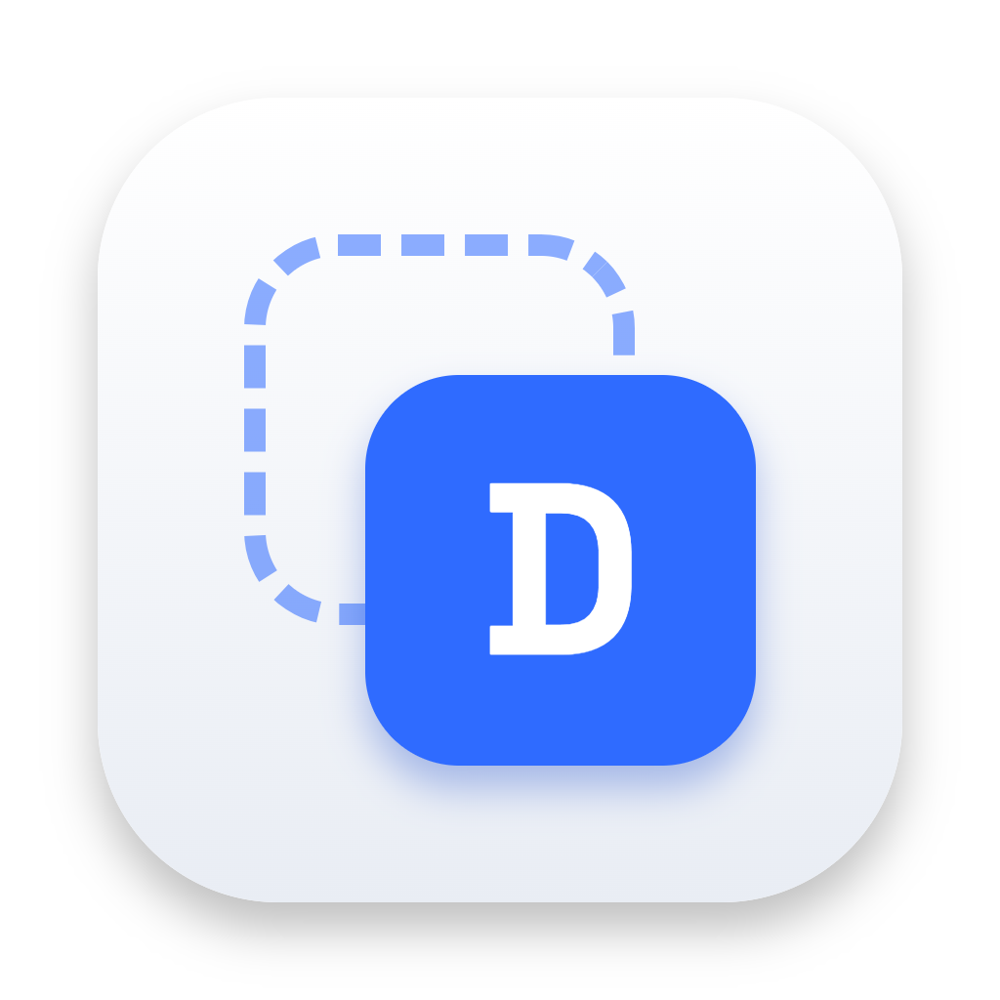

<p align="center">
  
</p>

<h1 align="center">DualMac</h1>

<p align="center">
  <strong>Run multiple independent instances of any macOS application with separate profiles, logins, and isolated data — similar to "Dual Apps" on Android.</strong>
</p>

<p align="center">
  
  
  
  
  
</p>

---

## 📖 Overview

On mobile platforms like Android, **Dual Apps** / **Parallel Space** lets users clone messaging and productivity apps to keep separate personal, work, and client accounts active simultaneously. 

On macOS, doing this manually is difficult:
- Electron and Chromium apps share the same local storage directory by default even if duplicated.
- macOS WindowServer and Dock route window focus back to the primary instance instead of spawning a second window.
- Duplicated app bundles crash under Gatekeeper due to invalidated code signatures or Mac App Store DRM receipts.

**DualMac** solves this completely. It is a native macOS application built with Swift and SwiftUI that automates profile isolation, app duplication, icon badging, ad-hoc re-signing, and multi-instance launching with zero required system modifications or SIP changes.

---

## ✨ Features

- ⚡ **Method A: Zero-Copy Profile Isolation (`--user-data-dir`)**:
  For Electron and Chromium apps (Claude Desktop, Google Chrome, Slack, VS Code, Discord, Spotify), DualMac runs instances with a dedicated, isolated profile folder without duplicating multi-gigabyte app bundles.
- 📦 **Method B: App Bundle Duplication & Ad-Hoc Re-Signing**:
  For native macOS apps (Telegram, IINA, etc.), DualMac clones the bundle into `~/Applications/DualMac/`, updates `CFBundleIdentifier`, strips `_MASReceipt`, re-signs ad-hoc (`codesign --force --deep --sign -`), and registers with LaunchServices.
- 🎨 **Custom Dock Badging & Tinting**:
  Every profile can have its own badge (e.g. "2", "W", "Work", or a custom label) with customizable high-contrast color pills/circles overlaid directly onto the app's Dock icon.
- 🟢 **Live Process Monitoring**:
  Real-time indicator shows whether each dual profile is actively **Running** (with a pulsing green status) or **Stopped**.
- 🛡️ **Data Isolation Verification Engine**:
  Built-in verification tool takes snapshots of the original application data directory and confirms that the primary directory has zero modifications while the profile folder writes its own independent data.
- ⚠️ **Automated Security & Compatibility Warnings**:
  Inspects embedded app entitlements and warns upfront about Mac App Store DRM receipts, Apple Team ID Keychain dependencies, and anti-tamper mechanisms.
- 🗑️ **Safe Profile Deletion**:
  When removing a profile, choose whether to delete only the launcher shortcut or wipe the profile's isolated data folder as well.
- 📋 **In-App Shell Command Log**:
  Every command DualMac executes (`open`, `codesign`, `plutil`, `iconutil`, `xattr`) is logged in real-time with exit codes, timestamps, and full outputs.
- 🔒 **Zero Privileges Needed**:
  DualMac operates entirely within user space (`~/Applications/DualMac` and `~/Library/Application Support/DualMac`). It never modifies the original `/Applications/` folder and never requires disabling SIP or running `sudo`.

---

## 🚀 Installation

### Option 1: Drag & Drop Disk Image (Recommended)
1. Download or locate `DualMac.dmg` in the `build/` folder.
2. Double-click **`DualMac.dmg`** to mount the installer.
3. Drag **DualMac** into your **Applications** folder.
4. Launch DualMac from Launchpad, Spotlight, or Finder!

```bash
open build/DualMac.dmg
```

### Option 2: Apple Installer Package (.pkg)
1. Double-click **`DualMac-1.0.0.pkg`**.
2. Follow the standard Apple Installer wizard to install DualMac directly into `/Applications`.

```bash
open build/DualMac-1.0.0.pkg
```

### Option 3: Build from Source
DualMac compiles using Apple Command Line Tools — no full 15GB Xcode.app installation is required.

```bash
# Clone the repository
git clone https://github.com/your-username/DualMac.git
cd DualMac

# Build the native .app bundle
./build.sh release

# Launch DualMac
open build/DualMac.app
```

To regenerate the DMG and PKG installers:
```bash
./package.sh
```

---

## 🛠️ How It Works Under the Hood

```
                        Installed Application
                                  │
             ┌────────────────────┴────────────────────┐
             ▼                                         ▼
  Electron / Chromium App?                    Native macOS App
 (Claude, Chrome, Slack, VS Code)                     │
             │                                         ▼
             ▼                                Mac App Store / Sandboxed?
   Method A: Data Isolation                            │
 --user-data-dir Profile Folder              ┌─────────┴─────────┐
    (Zero bundle disk copy)                  ▼                   ▼
                                       Direct Download       MAS Receipt
                                             │                   │
                                             ▼                   ▼
                                   Method B: Duplication   Method B + Warning /
                                  ~/Applications/DualMac/  Strip _MASReceipt /
                                  Ad-Hoc Re-sign + Badge   Method C: open -n -a
```

### 1. Method A: Profile Data Isolation
- Electron and Chromium apps read their storage directory from the `--user-data-dir` flag.
- Profiles are isolated inside:
  ```
  ~/Library/Application Support/DualMac/Profiles/<BundleID>/<ProfileSlug>/
  ```
- DualMac generates a lightweight launcher shortcut bundle in:
  ```
  ~/Applications/DualMac/<AppName> – <ProfileName>.app
  ```
  Containing the custom badged icon and a native executable that launches the profile with `--user-data-dir`.
- **MCP Server Isolation**: For apps like Claude Desktop, `claude_desktop_config.json` is read from the isolated profile directory, allowing completely independent MCP servers and configuration.

### 2. Method B: Bundle Duplication & Re-Signing
- The original `.app` bundle is copied into `~/Applications/DualMac/<AppName> – <ProfileName>.app`.
- `CFBundleIdentifier` is modified to `<originalID>.dual.<profileSlug>` and `CFBundleName` is updated.
- Any Mac App Store receipt (`Contents/_MASReceipt`) is removed.
- A new `.icns` file is generated using `/usr/bin/iconutil` with the custom badge overlay and replaced in `Contents/Resources/`.
- Extended quarantine attributes are cleared: `xattr -cr "<ClonePath>"`.
- The bundle is re-signed ad-hoc: `codesign --force --deep --sign - "<ClonePath>"`.
- LaunchServices is updated immediately: `lsregister -f "<ClonePath>"`.
- **Rule for Electron apps**: Even when using Method B, `--user-data-dir` is automatically passed to prevent Electron from falling back to its internal shared product name.

### 3. Method C: Multi-Instance Fallback
- For apps that support multiple windows natively, launches a secondary instance using `open -n -a "<AppPath>"`.

---

## 💡 Quick Start & Usage Guide

### Creating a Dual Profile
1. Launch **DualMac**.
2. Go to the **Installed Apps** tab.
3. Search or browse for the app you wish to clone (e.g. Claude, Chrome, Telegram).
4. Review the **Compatibility Analysis** (recommended method, framework detection, and security warnings).
5. Click **Create Dual Profile**.
6. Customize:
   - **Profile Name**: e.g. "Work", "Client", "Personal".
   - **Badge Label**: e.g. "2", "W", "P".
   - **Badge Color**: Choose from preset colors (Orange, Blue, Purple, Green, Pink, Mint, Red).
   - **Shape**: Circle or Rounded Rectangle.
7. Click **Create Profile**.

### Launching Profiles
- Click **Launch** inside the DualMac **Dual Profiles** tab, OR:
- Open the badged app shortcut directly from `~/Applications/DualMac/` or Spotlight!

---

## 🔑 First-Time OAuth / Browser Sign-In Guide

When an application uses a custom URL scheme (such as `claude://auth/callback` or `slack://`) for browser authentication:

1. When you click **Sign In**, the browser receives an authentication token and attempts to open `app-scheme://`.
2. macOS LaunchServices routes that link to the **primary active instance** of the application.
3. **One-Time Setup Tip**:
   - If you need to log in to a second account via browser callback, temporarily quit the primary instance (**Cmd + Q**).
   - Click **Sign In** in your second profile window.
   - Complete the browser login; macOS will deliver the callback directly to your second instance.
   - Once signed in, session cookies and tokens are permanently saved in the profile folder.
   - Re-open your primary instance. **Both will stay signed in to their respective accounts permanently across relaunches.**

---

## ⚠️ Known Limitations on macOS Sequoia

| Limitation | Cause | DualMac Handling |
| :--- | :--- | :--- |
| **Mac App Store DRM** | MAS apps include an encrypted receipt (`_MASReceipt`) tied to your Apple ID. | DualMac detects MAS receipts, warns the user, and strips the receipt. Direct downloads from developer websites are recommended. |
| **Team ID Keychain Entitlements** | Keychain access groups with Apple Team IDs (e.g. WhatsApp's `57T9237FN3.*`) require valid Apple Developer certificates. | DualMac detects Team ID entitlements and displays a warning that ad-hoc clones cannot access shared keychain items or iCloud. |
| **Method B Auto-Updates** | Duplicated bundles have modified bundle IDs and do not receive updates from the original app. | DualMac displays an informational note. To update a Method B clone, simply delete and recreate it from the updated original. |
| **Apple System Apps** | Apps in `/System/Applications` are sealed on the read-only Signed System Volume protected by SIP. | DualMac flags system apps and blocks duplication to prevent tampering. |

---

## 🧪 Tested Applications Matrix

| Application | Framework | Recommended Method | Test Status | Observed Notes |
| :--- | :--- | :---: | :---: | :--- |
| **Claude Desktop** | Electron | Method A | **PASS** | Perfect isolation. Separate cookies, local storage, and separate `claude_desktop_config.json` for MCP servers. |
| **Google Chrome** | Chromium | Method A | **PASS** | Native `--user-data-dir` isolation. Independent history, extensions, and logins. |
| **Visual Studio Code** | Electron | Method A | **PASS** | Independent workspaces, extensions, and settings. |
| **Telegram** | Native Swift | Method B | **PASS** | Stripping `_MASReceipt` and ad-hoc re-signing boots clean independent session. |
| **WhatsApp** | Native / Catalyst | Method B + Warning | **Conditional** | Shows warning for Team ID keychain and App Groups (`57T9237FN3`). |

---

## 📂 Project Structure

```
DualMac
├── Package.swift               # Swift Package Manager manifest
├── build.sh                    # Build & bundle script (Swift 6 CLI)
├── package.sh                  # DMG and PKG distribution packager
├── README.md                   # Complete documentation & user guide
├── Resources/
│   └── AppIcon.png             # Official 1024x1024 master icon
└── Sources/DualMac/
    ├── App/
    │   └── DualMacApp.swift    # SwiftUI application lifecycle
    ├── Models/
    │   ├── InstalledApp.swift  # Application metadata & analysis
    │   ├── DualProfile.swift   # Profile configurations & paths
    │   ├── CloningMethod.swift # Method A, B, and C definitions
    │   ├── AppWarning.swift    # Security, MAS, and keychain warnings
    │   ├── BadgeConfig.swift   # Icon badge customizations
    │   └── CommandLogEntry.swift # Shell execution log model
    ├── Services/
    │   ├── AppScannerService.swift     # Background /Applications scanner
    │   ├── AppAnalyzerService.swift    # Deep framework & entitlement inspection
    │   ├── CloningEngine.swift         # Profile creation & launch orchestrator
    │   ├── IconBadgeService.swift      # Dynamic icon badge & .icns renderer
    │   ├── ProcessMonitorService.swift # Real-time process monitor
    │   ├── IsolationVerifierService.swift # Data directory integrity checker
    │   ├── ProfileStorageService.swift # JSON persistence (~/Library/Application Support)
    │   └── CommandRunner.swift         # Shell execution engine & sudo guard
    ├── Views/
    │   ├── MainView.swift              # Unified sidebar navigation
    │   ├── AppCatalogView.swift        # App catalog with search & filters
    │   ├── AppDetailView.swift         # Compatibility inspector & create button
    │   ├── CreateProfileSheet.swift    # Live icon badge preview & profile creator
    │   ├── DualProfilesView.swift      # Active profiles, status, & actions
    │   └── CommandLogView.swift        # Live in-app shell command log viewer
    └── Resources/
        └── AppIcon.icns        # Compiled multi-resolution Apple icon
```

---

## 📄 License

This project is open-source and available under the [MIT License](LICENSE).
